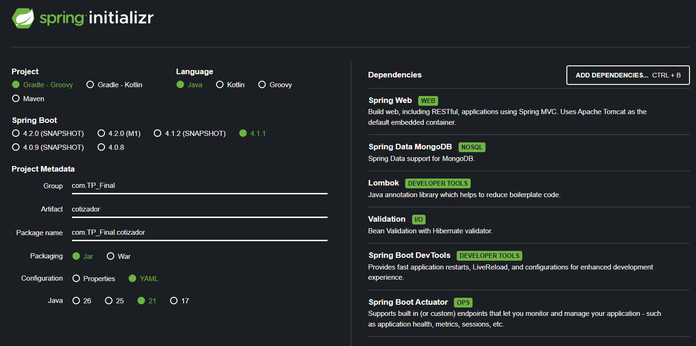

# 🚗 Cotizador de Seguros Automotores — Backend

Backend del Trabajo Final Integrador desarrollado con **Java + Spring Boot**. Actualmente el proyecto se encuentra en su **etapa inicial**: cuenta con la estructura generada por Spring Initializr, la configuración base y el esqueleto de la aplicación listo para comenzar a incorporar la lógica de negocio.

> **Estado del proyecto:** Scaffold inicial. Todavía no hay controladores, servicios, repositorios ni modelos implementados. Este README refleja **únicamente lo que existe hoy en el repositorio**.

---

## 📋 Tabla de Contenidos

- [Estado Actual](#-estado-actual)
- [Tecnologías y Dependencias](#️-tecnologías-y-dependencias)
- [Estructura del Proyecto](#-estructura-del-proyecto)
- [Configuración inicial con Spring Boot](#configuración-inicial-con-spring-boot)
- [Configuración Actual](#️-configuración-actual)
- [Variables de entorno](#variables-de-entorno)
- [Cómo ejecutar](#cómo-ejecutar)


---

## 📌 Estado Actual

El proyecto fue generado con **Spring Initializr** y contiene:

- Estructura de carpetas de Gradle (`gradle/wrapper`, `gradlew`, `gradlew.bat`).
- Archivo `build.gradle` con las dependencias seleccionadas.
- Archivo `settings.gradle` con el nombre del proyecto: `cotizador`.
- Clase principal `CotizadorApplication.java` con la anotación `@SpringBootApplication`.
- Archivo `application.yaml` con la configuración mínima de Spring y MongoDB.
- Archivo `README.md` (este documento).

---

## 🛠️ Tecnologías y Dependencias

### Stack principal

| Componente | Versión / Detalle |
| :--- | :--- |
| **Lenguaje** | Java 21 (LTS) |
| **Framework** | Spring Boot 4.1.1 |
| **Gestor de dependencias** | Gradle (Groovy DSL) |
| **Base de datos** | MongoDB (NoSQL) |
| **Build Tool wrapper** | Gradle Wrapper (incluido en el repo) |

### Dependencias declaradas en `build.gradle`

| Dependencia | Tipo | Propósito |
| :--- | :--- | :--- |
| `spring-boot-starter-actuator` | implementation | Endpoints de monitoreo y health checks. |
| `spring-boot-starter-data-mongodb` | implementation | Integración con MongoDB. |
| `spring-boot-starter-validation` | implementation | Validación de DTOs (Bean Validation). |
| `spring-boot-starter-webmvc` | implementation | API REST con Spring MVC. |
| `lombok` | compileOnly + annotationProcessor | Reducción de boilerplate (getters, setters, builders). |
| `spring-boot-devtools` | developmentOnly | Reinicio automático en desarrollo. |
| `spring-boot-starter-*-test` | testImplementation | Starters de testing para cada módulo. |
| `junit-platform-launcher` | testRuntimeOnly | Ejecución de tests con JUnit 5. |

---

## 📂 Estructura del Proyecto

```text
backend/
├── gradle/
│   └── wrapper/
│       ├── gradle-wrapper.jar
│       └── gradle-wrapper.properties
├── src/
│   ├── main/
│   │   ├── java/
│   │   │   └── com/TP_Final/cotizador/
│   │   │       └── CotizadorApplication.java
│   │   └── resources/
│   │       └── application.yaml
│   └── test/
│       └── java/
│           └── com/TP_Final/cotizador/
│               └── CotizadorApplicationTests.java
├── .env.example
├── .gitattributes
├── .gitignore
├── build.gradle
├── gradlew
├── gradlew.bat
├── README.md
└── settings.gradle
```

---

## Configuración inicial con Spring Boot



---

**Paquete raíz:** `com.TP_Final.cotizador`

---

## ⚙️ Configuración Actual

### `settings.gradle`
```groovy
rootProject.name = 'cotizador'
```

### `application.yaml`

El archivo `application.yaml` contiene la configuración
básica de Spring Boot y la conexión a MongoDB.

La URI de conexión se obtiene mediante la variable
de entorno `MONGODB_URI`, evitando incluir
credenciales directamente en el código fuente.

---


## Variables de entorno

| Variable | Descripción |
|---|---|
| MONGODB_URI | URI de conexión a MongoDB Atlas. |
| ARGAUTOS_API_KEY | Clave de acceso a ArgAutos. |
| ADMIN_USER | Usuario administrador. |
| ADMIN_PASSWORD | Contraseña del administrador. |

Las variables se encuentran documentadas en
`backend/.env.example` sin incluir credenciales reales.

Actualmente, `application.yaml` utiliza `MONGODB_URI`
para configurar la conexión con MongoDB.
Las variables `ARGAUTOS_API_KEY`, `ADMIN_USER` y
`ADMIN_PASSWORD` están documentadas para las
funcionalidades que se incorporarán posteriormente.

## Cómo ejecutar

Para ejecutar el backend es necesario tener Java 21 instalado y configurar la variable de entorno `MONGODB_URI` con una cadena de conexión válida. El archivo `.env.example` documenta las variables necesarias, pero no configura automáticamente el entorno.

Desde la carpeta `backend/`:

**Linux o macOS:**

```bash
./gradlew bootRun
```

**Windows:**

```powershell
.\gradlew.bat bootRun
```

Por defecto, Spring Boot utiliza el puerto 8080.
