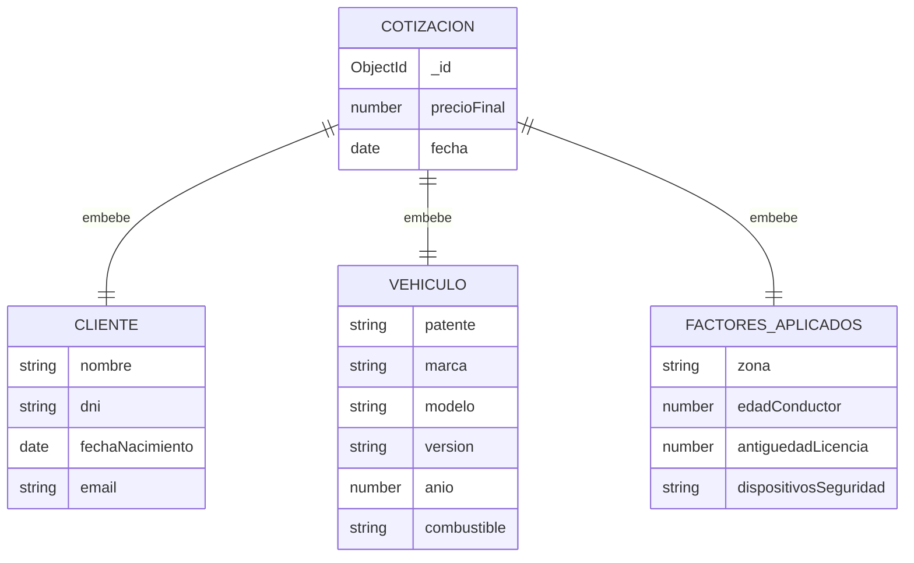

# Documentación del Sistema — Cotizador de Seguros Automotores

**Grupo 104** — Federico Quinteros, Lorenzo Pattini, Uriel Palma

---

## 1. Diseño y documentación de Base de Datos

### Motor y justificación
Se utiliza **MongoDB Atlas** (NoSQL, orientado a documentos) en lugar de una base relacional por:
- Esquema flexible: las cotizaciones pueden tener atributos variables sin necesidad de migraciones.
- Embedding de datos relacionados (cliente, vehículo, factores) en un solo documento, evitando joins.
- Alineación natural con JSON, el formato que ya maneja el backend en sus respuestas REST.
- Escalabilidad horizontal para el crecimiento futuro del proyecto.

### Base y colección
- **Base de datos:** `cotizador-tfi`
- **Colección principal:** `cotizaciones`

### Decisión de diseño: embedding vs. referencias
Se optó por embeber los datos del cliente, el vehículo y los factores aplicados dentro de cada documento de cotización, en lugar de crear colecciones separadas y referenciarlas. Motivo: una cotización es un registro histórico que no debe cambiar aunque el cliente actualice sus datos más adelante — necesitamos una "foto" congelada de la información tal como era en el momento de cotizar, no una referencia viva.

### Esquema

```json
{
  "_id": "ObjectId",
  "cliente": {
    "nombre": "string",
    "dni": "string",
    "fechaNacimiento": "date",
    "email": "string"
  },
  "vehiculo": {
    "patente": "string",
    "marca": "string",
    "modelo": "string",
    "version": "string",
    "anio": "number",
    "combustible": "string"
  },
  "factoresAplicados": {
    "zona": "string",
    "edadConductor": "number",
    "antiguedadLicencia": "number",
    "dispositivosSeguridad": ["string"]
  },
  "precioFinal": "number",
  "fecha": "date"
}
```

### Diagrama de la colección



### Evidencia
La base `cotizador-tfi` y la colección `cotizaciones` ya fueron creadas en el cluster de MongoDB Atlas del equipo, con un documento de ejemplo cargado que valida la estructura definida arriba.

---

## 2. Definición funcional de cada módulo

### Módulo 1 — Consulta de datos del vehículo
- **Descripción:** permite registrar la patente como dato informativo y seleccionar, de forma independiente, las características técnicas del vehículo mediante información provista por una API externa de vehículos.
- **Entrada:** patente ingresada manualmente por el usuario y selección de marca, modelo, año, versión y combustible, según los datos disponibles en la API externa.
- **Proceso:** la patente no se envía a la API para consultar, validar ni recuperar información. La consulta externa se utiliza únicamente como fuente de datos para la selección de características del vehículo.
- **Salida:** objeto `vehiculo` con la patente informativa y los datos técnicos seleccionados, que se utilizarán en el módulo de cálculo y se conservarán en la cotización.

### Módulo 2 — Gestión de usuarios/prospectos
- **Descripción:** registra los datos del titular y conductor, y mantiene el historial de cotizaciones por cliente.
- **Entrada:** datos personales ingresados por el usuario (nombre, DNI, fecha de nacimiento, email).
- **Salida:** documento `cliente` embebido en cada cotización asociada.

### Módulo 3 — Motor de cálculo de cotización
- **Descripción:** aplica las reglas de negocio (factor regional, personal y del vehículo) sobre un valor base para generar el precio final.
- **Entrada:** datos del cliente, del vehículo y de la zona.
- **Salida:** documento `cotizacion` completo, persistido en la colección `cotizaciones`.

### Módulo 4 — Dashboard de estadísticas
- **Descripción:** presenta el embudo de conversión (cotización → compra) y un mapa de calor geográfico por zona.
- **Entrada:** lectura agregada sobre la colección `cotizaciones`.
- **Salida:** visualizaciones para el equipo comercial.

---

## 3. Requerimientos funcionales y no funcionales

### Funcionales
- El sistema debe permitir ingresar y registrar la patente como dato informativo, sin usarla para consultar o validar información en una API externa.
- El sistema debe permitir seleccionar marca, modelo, año, versión y combustible a partir de información disponible en una API externa de vehículos, de forma independiente de la patente.
- El sistema debe permitir registrar los datos del cliente y del conductor.
- El sistema debe calcular el precio final de la póliza aplicando las reglas de negocio vigentes.
- El sistema debe generar cotizaciones para varias aseguradoras de forma simultánea.
- El sistema debe conservar el historial de cotizaciones por cliente.
- El sistema debe mostrar estadísticas de conversión y demanda por zona.

### No funcionales

## Requerimientos No Funcionales (RNF)

### RNF-01 – Usabilidad

El sistema deberá contar con una interfaz clara e intuitiva, que permita a los usuarios identificar los campos obligatorios, ingresar la información necesaria y consultar los resultados de una cotización.

**Criterios de cumplimiento:**
- Los formularios deberán identificar los campos obligatorios.
- Los errores de ingreso deberán mostrarse mediante mensajes comprensibles.
- Los resultados deberán presentar claramente la aseguradora, cobertura y precio calculado.
- El usuario deberá poder identificar cómo continuar o corregir los datos ingresados.

**Verificación:** Pruebas manuales del recorrido de cotización, tanto con datos válidos como inválidos.

### RNF-02 – Diseño adaptable (Responsive)

La interfaz deberá adaptarse a diferentes tamaños de pantalla, permitiendo utilizar las funcionalidades principales desde computadoras y dispositivos móviles.

**Criterios de cumplimiento:**
- Las pantallas principales deberán visualizarse correctamente en resoluciones de escritorio y dispositivos móviles.
- Los formularios y botones deberán permanecer accesibles.
- No deberá existir desplazamiento horizontal innecesario debido al diseño.
- La información de las cotizaciones deberá poder leerse sin superposiciones.

**Verificación:** Pruebas manuales utilizando las herramientas de dispositivos de Google Chrome, con anchos de pantalla de 375 px, 768 px y 1366 px.

### RNF-03 – Rendimiento

El sistema deberá responder en tiempos razonables durante las operaciones principales, considerando condiciones normales de conexión y disponibilidad de los servicios externos.

**Criterios de cumplimiento:**
- Las operaciones de consulta de cotizaciones almacenadas deberán responder en un máximo de 5 segundos.
- El cálculo de una cotización con datos válidos deberá completarse en un máximo de 5 segundos cuando no dependa de llamadas externas.
- Durante las consultas a APIs externas, la interfaz deberá informar al usuario que la operación se encuentra en proceso.

**Verificación:** Pruebas manuales utilizando las herramientas de red del navegador y registros del backend, en condiciones normales de funcionamiento.

*Los tiempos no incluyen demoras excepcionales de servicios externos ni el arranque en frío del servidor de Render.*

### RNF-04 – Seguridad y protección de datos

El sistema deberá aplicar medidas básicas de seguridad para proteger la información personal registrada y evitar la exposición de credenciales de acceso a servicios externos.

**Criterios de cumplimiento:**
- Las comunicaciones entre frontend y backend desplegados deberán utilizar HTTPS.
- Las credenciales de MongoDB Atlas y otras claves privadas deberán almacenarse mediante variables de entorno del backend.
- No deberán incluirse contraseñas ni claves privadas dentro del repositorio GitHub.
- El backend deberá validar los datos recibidos antes de procesarlos o almacenarlos.
- Las respuestas de error no deberán mostrar contraseñas ni información de configuración interna.

**Verificación:** Revisión del repositorio, configuración de Vercel y Render, y pruebas de validación de entradas en la API.

### RNF-05 – Compatibilidad

El frontend deberá funcionar correctamente en navegadores web modernos.

**Criterios de cumplimiento:**
- La aplicación deberá poder ejecutarse en las versiones actuales de Google Chrome y Microsoft Edge.
- Las funcionalidades principales deberán mantener un comportamiento consistente en ambos navegadores.
- El sistema no deberá requerir extensiones adicionales para su utilización.

**Verificación:** Pruebas manuales del flujo principal de cotización en Chrome y Edge.

### RNF-06 – Mantenibilidad

El código fuente deberá organizarse de manera que facilite su comprensión, modificación y ampliación por los integrantes del grupo.

**Criterios de cumplimiento:**
- El frontend deberá separar componentes, páginas, servicios y tipos de datos.
- El backend deberá mantener separadas las responsabilidades de controladores, servicios y acceso a datos.
- Las configuraciones dependientes del entorno deberán mantenerse fuera de la lógica de negocio.
- El proyecto deberá contar con instrucciones de instalación y ejecución en sus archivos README.
- El frontend deberá superar las verificaciones de compilación y análisis estático configuradas en el proyecto.

**Verificación:** Revisión de la estructura del repositorio, documentación técnica y ejecución de `npm run lint` y `npm run build`.

### RNF-07 – Manejo de errores

El sistema deberá informar de manera comprensible los errores que puedan ocurrir durante la carga de información, las consultas externas o la generación de cotizaciones.

**Criterios de cumplimiento:**
- Los formularios deberán identificar entradas inválidas o incompletas.
- Si una API externa no responde, el sistema deberá mostrar un mensaje informativo.
- Si no puede generarse una cotización, se deberá informar al usuario sin mostrar errores técnicos internos.
- La aplicación no deberá quedar bloqueada permanentemente ante una solicitud fallida.

**Verificación:** Pruebas manuales con campos inválidos, interrupciones simuladas de conexión y respuestas de error del backend.

### RNF-08 – Despliegue y ejecución

El sistema deberá poder ejecutarse en un entorno local de desarrollo y publicarse utilizando las plataformas seleccionadas por el equipo.

**Criterios de cumplimiento:**
- El frontend deberá poder ejecutarse localmente mediante `npm install` y `npm run dev`.
- El backend deberá contar con instrucciones para su ejecución local.
- El frontend deberá poder generar una compilación de producción mediante `npm run build`.
- La aplicación deberá poder desplegarse en Vercel y comunicarse con el backend publicado en Render.
- El backend deberá poder conectarse a MongoDB Atlas mediante su configuración correspondiente.

**Verificación:** Ejecución local de ambos proyectos, compilación del frontend y prueba de una operación completa de cotización en el entorno desplegado.

---

## 4. Reglas de negocio

La prima final se calcula aplicando reglas secuenciales sobre un valor base:
- **Factor Regional:** multiplicador según zona/código postal (zonas de mayor o menor riesgo).
- **Factor Personal:** recargo para conductores menores de 25 años; ajuste según antigüedad de la licencia de conducir.
- **Factor del Vehículo:** ajuste según tipo de combustible (nafta/diésel/eléctrico); descuentos por dispositivos de seguridad (alarma, GPS, cortacorriente).

*(Los valores numéricos exactos de cada factor —porcentajes y rangos— se definen en equipo.)*

---

## 5. Diagramas

- **Diagrama de flujo general del sistema:** ver `docs/TP_Final_Diagrama_de_Flujo.jpg` (versión editable: `docs/TP_Final_Diagrama_de_Flujo.drawio`). La patente se registra como dato informativo; la API se consulta a partir de la selección de características del vehículo, no mediante la patente.
- **Diagrama de la colección de MongoDB:** incluido en la sección 1 de este documento.
- *(Diagrama de componentes/clases del backend: a definir en equipo.)*
