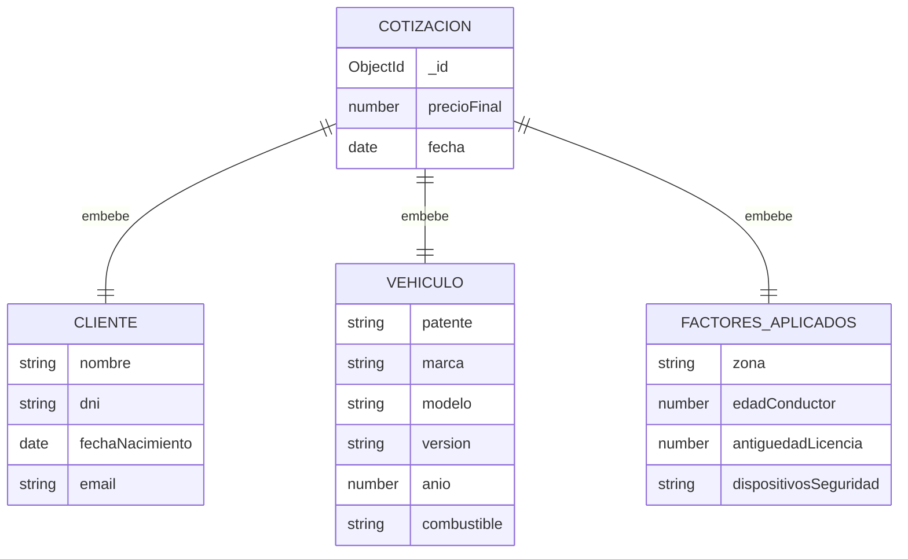

# Documentación del Sistema — Cotizador de Seguros Automotores

**Grupo 104** — Federico Quinteros, Lorenzo Pattini, Uriel Palma

---

## 1. Diseño y documentación de Base de Datos

### 1.1 Motor y justificación
Se utiliza **MongoDB Atlas** (NoSQL, orientado a documentos) en lugar de una base relacional por:
- Esquema flexible: las cotizaciones pueden tener atributos variables sin necesidad de migraciones.
- Embedding de datos relacionados (cliente, vehículo, factores) en un solo documento, evitando joins.
- Alineación natural con JSON, el formato que ya maneja el backend en sus respuestas REST.
- Escalabilidad horizontal para el crecimiento futuro del proyecto.

### 1.2 Base y colección
- **Base de datos:** `cotizador-tfi`
- **Colección principal:** `cotizaciones`

### 1.3 Decisión de diseño: embedding vs. referencias
Se optó por embeber los datos del cliente, el vehículo y los factores aplicados dentro de cada documento de cotización, en lugar de crear colecciones separadas y referenciarlas. Motivo: una cotización es un registro histórico que no debe cambiar aunque el cliente actualice sus datos más adelante — necesitamos una "foto" congelada de la información tal como era en el momento de cotizar, no una referencia viva.

### 1.4 Esquema

```json
{
  "_id": "ObjectId",
  "cliente": {
    "nombre": "string",
    "dni": "string",
    "fechaNacimiento": "date",
    "email": "string"
  },
  "vehiculo": {
    "patente": "string",
    "marca": "string",
    "modelo": "string",
    "version": "string",
    "anio": "number",
    "combustible": "string"
  },
  "factoresAplicados": {
    "zona": "string",
    "edadConductor": "number",
    "antiguedadLicencia": "number",
    "dispositivosSeguridad": ["string"]
  },
  "precioFinal": "number",
  "fecha": "date"
}
```

### 1.5 Diagrama de la colección



### 1.6 Evidencia
La base `cotizador-tfi` y la colección `cotizaciones` ya fueron creadas en el cluster de MongoDB Atlas del equipo, con un documento de ejemplo cargado que valida la estructura definida arriba.

---

## 2. Definición funcional de cada módulo

### Módulo 1 — Consulta de datos del vehículo
- **Descripción:** permite registrar la patente como dato informativo y seleccionar, de forma independiente, las características técnicas del vehículo mediante información provista por una API externa de vehículos.
- **Entrada:** patente ingresada manualmente por el usuario y selección de marca, modelo, año, versión y combustible, según los datos disponibles en la API externa.
- **Proceso:** la patente no se envía a la API para consultar, validar ni recuperar información. La consulta externa se utiliza únicamente como fuente de datos para la selección de características del vehículo.
- **Salida:** objeto `vehiculo` con la patente informativa y los datos técnicos seleccionados, que se utilizarán en el módulo de cálculo y se conservarán en la cotización.

### Módulo 2 — Gestión de usuarios/prospectos
- **Descripción:** registra los datos del titular y conductor, y mantiene el historial de cotizaciones por cliente.
- **Entrada:** datos personales ingresados por el usuario (nombre, DNI, fecha de nacimiento, email).
- **Salida:** documento `cliente` embebido en cada cotización asociada.

### Módulo 3 — Motor de cálculo de cotización
- **Descripción:** aplica las reglas de negocio (factor regional, personal y del vehículo) sobre un valor base para generar el precio final.
- **Entrada:** datos del cliente, del vehículo y de la zona.
- **Salida:** documento `cotizacion` completo, persistido en la colección `cotizaciones`.

### Módulo 4 — Dashboard de estadísticas
- **Descripción:** presenta el embudo de conversión (cotización → compra) y un mapa de calor geográfico por zona.
- **Entrada:** lectura agregada sobre la colección `cotizaciones`.
- **Salida:** visualizaciones para el equipo comercial.

---

## 3. Requerimientos funcionales y no funcionales

### 3.1 Funcionales
- El sistema debe permitir ingresar y registrar la patente como dato informativo, sin usarla para consultar o validar información en una API externa.
- El sistema debe permitir seleccionar marca, modelo, año, versión y combustible a partir de información disponible en una API externa de vehículos, de forma independiente de la patente.
- El sistema debe permitir registrar los datos del cliente y del conductor.
- El sistema debe calcular el precio final de la póliza aplicando las reglas de negocio vigentes.
- El sistema debe generar cotizaciones para varias aseguradoras de forma simultánea.
- El sistema debe conservar el historial de cotizaciones por cliente.
- El sistema debe mostrar estadísticas de conversión y demanda por zona.

### 3.2 No funcionales

### RNF-01 – Usabilidad

El sistema deberá contar con una interfaz clara e intuitiva, que permita a los usuarios identificar los campos obligatorios, ingresar la información necesaria y consultar los resultados de una cotización.

**Criterios de cumplimiento:**
- Los formularios deberán identificar los campos obligatorios.
- Los errores de ingreso deberán mostrarse mediante mensajes comprensibles.
- Los resultados deberán presentar claramente la aseguradora, cobertura y precio calculado.
- El usuario deberá poder identificar cómo continuar o corregir los datos ingresados.

**Verificación:** Pruebas manuales del recorrido de cotización, tanto con datos válidos como inválidos.

### RNF-02 – Diseño adaptable (Responsive)

La interfaz deberá adaptarse a diferentes tamaños de pantalla, permitiendo utilizar las funcionalidades principales desde computadoras y dispositivos móviles.

**Criterios de cumplimiento:**
- Las pantallas principales deberán visualizarse correctamente en resoluciones de escritorio y dispositivos móviles.
- Los formularios y botones deberán permanecer accesibles.
- No deberá existir desplazamiento horizontal innecesario debido al diseño.
- La información de las cotizaciones deberá poder leerse sin superposiciones.

**Verificación:** Pruebas manuales utilizando las herramientas de dispositivos de Google Chrome, con anchos de pantalla de 375 px, 768 px y 1366 px.

### RNF-03 – Rendimiento

El sistema deberá responder en tiempos razonables durante las operaciones principales, considerando condiciones normales de conexión y disponibilidad de los servicios externos.

**Criterios de cumplimiento:**
- Las operaciones de consulta de cotizaciones almacenadas deberán responder en un máximo de 5 segundos.
- El cálculo de una cotización con datos válidos deberá completarse en un máximo de 5 segundos cuando no dependa de llamadas externas.
- Durante las consultas a APIs externas, la interfaz deberá informar al usuario que la operación se encuentra en proceso.

**Verificación:** Pruebas manuales utilizando las herramientas de red del navegador y registros del backend, en condiciones normales de funcionamiento.

*Los tiempos no incluyen demoras excepcionales de servicios externos ni el arranque en frío del servidor de Render.*

### RNF-04 – Seguridad y protección de datos

El sistema deberá aplicar medidas básicas de seguridad para proteger la información personal registrada y evitar la exposición de credenciales de acceso a servicios externos.

**Criterios de cumplimiento:**
- Las comunicaciones entre frontend y backend desplegados deberán utilizar HTTPS.
- Las credenciales de MongoDB Atlas y otras claves privadas deberán almacenarse mediante variables de entorno del backend.
- No deberán incluirse contraseñas ni claves privadas dentro del repositorio GitHub.
- El backend deberá validar los datos recibidos antes de procesarlos o almacenarlos.
- Las respuestas de error no deberán mostrar contraseñas ni información de configuración interna.

**Verificación:** Revisión del repositorio, configuración de Vercel y Render, y pruebas de validación de entradas en la API.

### RNF-05 – Compatibilidad

El frontend deberá funcionar correctamente en navegadores web modernos.

**Criterios de cumplimiento:**
- La aplicación deberá poder ejecutarse en las versiones actuales de Google Chrome y Microsoft Edge.
- Las funcionalidades principales deberán mantener un comportamiento consistente en ambos navegadores.
- El sistema no deberá requerir extensiones adicionales para su utilización.

**Verificación:** Pruebas manuales del flujo principal de cotización en Chrome y Edge.

### RNF-06 – Mantenibilidad

El código fuente deberá organizarse de manera que facilite su comprensión, modificación y ampliación por los integrantes del grupo.

**Criterios de cumplimiento:**
- El frontend deberá separar componentes, páginas, servicios y tipos de datos.
- El backend deberá mantener separadas las responsabilidades de controladores, servicios y acceso a datos.
- Las configuraciones dependientes del entorno deberán mantenerse fuera de la lógica de negocio.
- El proyecto deberá contar con instrucciones de instalación y ejecución en sus archivos README.
- El frontend deberá superar las verificaciones de compilación y análisis estático configuradas en el proyecto.

**Verificación:** Revisión de la estructura del repositorio, documentación técnica y ejecución de `npm run lint` y `npm run build`.

### RNF-07 – Manejo de errores

El sistema deberá informar de manera comprensible los errores que puedan ocurrir durante la carga de información, las consultas externas o la generación de cotizaciones.

**Criterios de cumplimiento:**
- Los formularios deberán identificar entradas inválidas o incompletas.
- Si una API externa no responde, el sistema deberá mostrar un mensaje informativo.
- Si no puede generarse una cotización, se deberá informar al usuario sin mostrar errores técnicos internos.
- La aplicación no deberá quedar bloqueada permanentemente ante una solicitud fallida.

**Verificación:** Pruebas manuales con campos inválidos, interrupciones simuladas de conexión y respuestas de error del backend.

### RNF-08 – Despliegue y ejecución

El sistema deberá poder ejecutarse en un entorno local de desarrollo y publicarse utilizando las plataformas seleccionadas por el equipo.

**Criterios de cumplimiento:**
- El frontend deberá poder ejecutarse localmente mediante `npm install` y `npm run dev`.
- El backend deberá contar con instrucciones para su ejecución local.
- El frontend deberá poder generar una compilación de producción mediante `npm run build`.
- La aplicación deberá poder desplegarse en Vercel y comunicarse con el backend publicado en Render.
- El backend deberá poder conectarse a MongoDB Atlas mediante su configuración correspondiente.

**Verificación:** Ejecución local de ambos proyectos, compilación del frontend y prueba de una operación completa de cotización en el entorno desplegado.

---

## 4. # Reglas de Negocio y Lógica de Cálculo de Cotizaciones

### 4.1 Descripción general

El sistema Cotizador de Seguros Automotores permitirá generar cotizaciones personalizadas a partir de los datos del vehículo, del conductor y de su ubicación geográfica.

Para determinar el precio de una póliza se utilizará un algoritmo de cálculo multicriterio que aplicará diferentes factores de ajuste sobre una prima base establecida para cada aseguradora y tipo de cobertura.

Los factores contemplados serán:

- Zona geográfica del conductor.
- Edad del conductor.
- Antigüedad de la licencia de conducir.
- Tipo de combustible del vehículo.
- Antigüedad del vehículo.
- Dispositivos de seguridad instalados.

El sistema permitirá generar y comparar cotizaciones de distintas aseguradoras utilizando los mismos datos ingresados por el usuario.

**Los importes y porcentajes definidos son valores simulados con fines académicos y no representan tarifas reales de compañías aseguradoras.**

### 4.2 Fórmula general de cálculo

El precio final mensual se calculará mediante la siguiente fórmula:

**Prima Final = Prima Base × Factor Zona × Factor Edad × Factor Licencia × Factor Combustible × Factor Antigüedad Vehículo × Factor Seguridad**

Donde:

| Variable | Descripción |
|---|---|
| Prima Base | Importe inicial establecido por cada aseguradora para una cobertura determinada. |
| Factor Zona | Ajuste correspondiente al nivel de riesgo de la zona geográfica. |
| Factor Edad | Ajuste según la edad del conductor. |
| Factor Licencia | Ajuste según la antigüedad de la licencia de conducir. |
| Factor Combustible | Ajuste según el tipo de combustible del vehículo. |
| Factor Antigüedad Vehículo | Ajuste según los años transcurridos desde el año de fabricación del automóvil. |
| Factor Seguridad | Descuento aplicado por los dispositivos de seguridad instalados. |
| Prima Final | Importe mensual resultante de aplicar todos los factores. |

Cada factor tendrá como valor de referencia **1,00**, que representa la ausencia de modificaciones.

- Un factor mayor que 1,00 representa un recargo.
- Un factor menor que 1,00 representa un descuento.
- Un factor igual a 1,00 no modifica el importe.

Los factores se aplicarán de forma multiplicativa y el resultado se redondeará a dos decimales al finalizar el cálculo.

### 4.3 Reglas de negocio

#### RN-01 – Factor geográfico

El sistema aplicará un factor según el código postal informado por el conductor.

Para el alcance inicial se establecerá una clasificación de códigos postales de prueba en tres categorías.

| Clasificación | Factor | Ajuste |
|---|---|---|
| Riesgo bajo | 0,95 | Descuento del 5 % |
| Riesgo medio | 1,00 | Sin modificación |
| Riesgo alto | 1,20 | Recargo del 20 % |

La relación entre códigos postales y categorías de riesgo será definida mediante una configuración interna.

Si el código postal no se encuentra configurado, el sistema informará que no es posible determinar el factor geográfico y solicitará una ubicación válida.

#### RN-02 – Factor por edad del conductor

El sistema calculará la edad del conductor a partir de su fecha de nacimiento.

| Edad del conductor | Factor | Ajuste |
|---|---|---|
| Menor de 18 años | No aplica | No se permite cotizar |
| Entre 18 y 24 años | 1,20 | Recargo del 20 % |
| Entre 25 y 65 años | 1,00 | Sin modificación |
| Mayor de 65 años | 1,10 | Recargo del 10 % |

El conductor deberá tener al menos 18 años para generar una cotización.

La edad se calculará considerando la fecha en la que se realiza la solicitud.

#### RN-03 – Factor por antigüedad de licencia

El sistema aplicará un ajuste según los años completos transcurridos desde la obtención de la licencia de conducir.

| Antigüedad | Factor | Ajuste |
|---|---|---|
| Menos de 2 años | 1,15 | Recargo del 15 % |
| Entre 2 y 5 años, inclusive | 1,05 | Recargo del 5 % |
| Más de 5 años | 1,00 | Sin modificación |

La antigüedad no podrá ser negativa y deberá ser coherente con la edad del conductor.

#### RN-04 – Factor por tipo de combustible

El sistema aplicará un factor según el tipo de combustible seleccionado.

| Combustible | Factor | Ajuste |
|---|---|---|
| Nafta | 1,00 | Sin modificación |
| Diésel | 1,05 | Recargo del 5 % |
| GNC | 1,03 | Recargo del 3 % |
| Híbrido | 0,98 | Descuento del 2 % |
| Eléctrico | 0,95 | Descuento del 5 % |

El tipo de combustible formará parte de los datos técnicos obtenidos mediante la consulta a la API externa de vehículos.

#### RN-05 – Factor por antigüedad del vehículo

El sistema deberá aplicar un factor según la antigüedad del automóvil, calculada a partir de su año de fabricación.

Para simplificar el modelo académico, se utilizará la siguiente fórmula:

**Antigüedad del vehículo = Año de cotización − Año de fabricación**

| Antigüedad del vehículo | Factor | Ajuste |
|---|---|---|
| 0 a 2 años | 0,95 | Descuento del 5 % |
| 3 a 5 años | 1,00 | Sin modificación |
| 6 a 10 años | 1,10 | Recargo del 10 % |
| 11 a 15 años | 1,20 | Recargo del 20 % |
| Más de 15 años | 1,35 | Recargo del 35 % |

El cálculo se realizará utilizando el año correspondiente a la fecha de generación de la cotización.

El año de fabricación no podrá ser posterior al año de cotización ni anterior a 1900.

Para esta primera versión, todos los vehículos dentro del rango permitido podrán cotizarse, independientemente de su antigüedad. No se establecerán exclusiones por antigüedad ni restricciones adicionales por tipo de cobertura.

**Ejemplo:**

Si un vehículo fue fabricado en 2018 y la cotización se realiza en 2026:

Antigüedad = 2026 − 2018 = 8 años.

Por lo tanto, corresponde aplicar el factor **1,10**, equivalente a un recargo del 10 %.

Este factor permite que el año de fabricación influya directamente en el precio calculado.

#### RN-06 – Factor por dispositivos de seguridad

El sistema aplicará descuentos según los dispositivos de seguridad declarados por el usuario.

| Dispositivo | Descuento |
|---|---|
| Alarma | 3 % |
| GPS | 5 % |
| Cortacorriente | 2 % |

Los descuentos serán acumulativos hasta un máximo del 10 %.

**Factor Seguridad = 1 − Suma de descuentos aplicables**

Por ejemplo, si el vehículo cuenta con alarma y GPS:

Factor Seguridad = 1 − (0,03 + 0,05)

**Factor Seguridad = 0,92**

Si no posee dispositivos de seguridad, el factor será 1,00.

#### RN-07 – Prima base por aseguradora y cobertura

Cada aseguradora tendrá una prima base configurada para cada cobertura que ofrezca.

Para la primera versión del sistema se trabajará con tres aseguradoras ficticias y tres tipos de cobertura.

| Aseguradora | Responsabilidad civil | Terceros completo | Todo riesgo |
|---|---:|---:|---:|
| Aseguradora A | $30.000 | $50.000 | $80.000 |
| Aseguradora B | $32.000 | $48.000 | $85.000 |
| Aseguradora C | $28.000 | $52.000 | $78.000 |

Los importes representan primas base mensuales simuladas, expresadas en pesos argentinos.

Todas las aseguradoras utilizarán la misma fórmula general durante la primera versión. La diferencia de precios dependerá de la prima base configurada para cada aseguradora y cobertura.

#### RN-08 – Registro informativo de la patente

La patente deberá ser ingresada por el usuario y almacenada junto con los datos del vehículo.

Tendrá carácter exclusivamente informativo.

No se utilizará para consultar APIs externas, recuperar características técnicas del vehículo ni modificar el importe de la cotización.

#### RN-09 – Obtención de datos técnicos del vehículo

La información técnica se obtendrá mediante una API externa que permita consultar y seleccionar características del vehículo independientemente de su patente.

Los datos contemplados serán:

- Marca.
- Modelo.
- Año de fabricación.
- Versión.
- Tipo de combustible.

El año de fabricación será utilizado para calcular el factor de antigüedad del vehículo.

En caso de que la API no esté disponible, el sistema informará el inconveniente y no continuará con la cotización hasta disponer de los datos obligatorios.

#### RN-10 – Validación de información

Antes de generar una cotización, el backend deberá verificar que los datos obligatorios estén completos y sean válidos.

Se contemplarán las siguientes validaciones:

- Edad mínima del conductor: 18 años.
- Fecha de nacimiento válida y no futura.
- Antigüedad de licencia no negativa y coherente con la edad.
- Código postal existente dentro de la configuración.
- Marca, modelo, versión y año de fabricación válidos.
- Año de fabricación comprendido entre 1900 y el año de cotización.
- Tipo de combustible admitido.
- Cobertura seleccionada y disponible.

Si algún dato no cumple las condiciones, el sistema deberá informar el error y evitar la generación de la cotización hasta que sea corregido.

#### RN-11 – Redondeo de importes

El sistema conservará la precisión decimal durante la aplicación de todos los factores.

El redondeo se realizará una única vez al finalizar el cálculo de cada propuesta.

El importe final se expresará en pesos argentinos con dos decimales.

Se utilizará el criterio de redondeo convencional, mediante `BigDecimal` y `RoundingMode.HALF_UP` en Java.

#### RN-12 – Persistencia del historial

Cada cotización generada se almacenará en MongoDB Atlas para permitir su consulta posterior.

Se conservarán como mínimo:

- Identificador de la cotización.
- Identificación del usuario o prospecto.
- Datos del vehículo, incluyendo la patente informativa.
- Año de fabricación y antigüedad calculada del vehículo.
- Datos del conductor utilizados.
- Código postal y categoría de riesgo.
- Factores aplicados.
- Aseguradoras y coberturas cotizadas.
- Primas base e importes finales.
- Fecha y hora de generación.

Las cotizaciones anteriores conservarán sus valores históricos aunque posteriormente cambien las primas base o los factores configurados.

#### RN-13 – Comparación de cotizaciones

El sistema generará una propuesta por cada aseguradora que ofrezca la cobertura solicitada.

Todas las propuestas utilizarán los mismos datos del vehículo y conductor y los mismos factores de ajuste, diferenciándose por la prima base de cada aseguradora.

Los resultados mostrarán:

- Nombre de la aseguradora.
- Tipo de cobertura.
- Precio mensual calculado.

Las propuestas podrán ordenarse de menor a mayor precio.

Si una aseguradora no ofrece una determinada cobertura, no se generará una cotización para esa combinación.

### 4.4 Ejemplo de aplicación del algoritmo

Se presenta un ejemplo de cálculo correspondiente a una cobertura de Terceros Completo.

#### Datos ingresados

| Dato | Valor |
|---|---|
| Edad del conductor | 23 años |
| Antigüedad de licencia | 1 año |
| Zona geográfica | Riesgo alto |
| Combustible | Diésel |
| Año del vehículo | 2018 |
| Año de cotización | 2026 |
| Antigüedad del vehículo | 8 años |
| Dispositivos de seguridad | Alarma y GPS |
| Cobertura | Terceros Completo |

#### Factores aplicables

| Concepto | Factor |
|---|---:|
| Zona geográfica | 1,20 |
| Edad del conductor | 1,20 |
| Antigüedad de licencia | 1,15 |
| Combustible | 1,05 |
| Antigüedad del vehículo | 1,10 |
| Dispositivos de seguridad | 0,92 |

#### Cálculo para Aseguradora A

Prima base: $50.000.

**Prima Final = 50.000 × 1,20 × 1,20 × 1,15 × 1,05 × 1,10 × 0,92**

**Prima Final = $87.983,28**

Este procedimiento se repetirá para las demás aseguradoras, utilizando sus respectivas primas base.

#### Resultados comparativos

| Aseguradora | Prima base | Prima final |
|---|---:|---:|
| Aseguradora A | $50.000 | $87.983,28 |
| Aseguradora B | $48.000 | $84.463,95 |
| Aseguradora C | $52.000 | $91.502,61 |

Los resultados son simulaciones académicas y no representan ofertas comerciales reales.

### 4.5 Implementación técnica prevista

La lógica de cotización se implementará en el backend desarrollado con Java y Spring Boot.

El frontend React + TypeScript recopilará los datos ingresados por el usuario, los enviará a la API REST y presentará las propuestas calculadas.

El backend deberá:

1. Recibir la solicitud de cotización.
2. Validar los datos ingresados.
3. Calcular la edad del conductor y la antigüedad de la licencia.
4. Calcular la antigüedad del vehículo a partir de su año de fabricación.
5. Determinar los factores de ajuste.
6. Recuperar las primas base configuradas.
7. Aplicar la fórmula de cálculo por aseguradora.
8. Redondear los importes finales.
9. Almacenar la cotización y sus factores en MongoDB Atlas.
10. Devolver las propuestas al frontend.

Las primas base y los factores podrán almacenarse como datos configurables en MongoDB Atlas, evitando incorporar valores fijos directamente en la lógica de cálculo.

Para el desarrollo inicial se utilizará un único motor de cotización compartido por las aseguradoras ficticias.

### 4.6 Consideraciones y limitaciones

El algoritmo constituye un modelo simplificado diseñado con fines académicos.

No contempla todos los factores reales del mercado asegurador, como siniestralidad histórica, valor comercial del automóvil, tasas regulatorias, franquicias, impuestos o condiciones contractuales.

En esta primera versión, la marca, el modelo y la versión serán datos identificatorios, mientras que el año de fabricación sí modificará el precio mediante el factor de antigüedad.

Los factores y primas base podrán ajustarse durante el desarrollo, siempre que se documenten los cambios y se mantenga la coherencia entre las reglas definidas y el algoritmo implementado.

El objetivo principal es demostrar la aplicación de reglas de negocio, la automatización del cálculo, la comparación entre aseguradoras y la integración entre frontend, backend y base de datos.

---

## 5. Diagramas

- **Diagrama de flujo general del sistema:** ver `docs/TP_Final_Diagrama_de_Flujo.jpg` (versión editable: `docs/TP_Final_Diagrama_de_Flujo.drawio`). La patente se registra como dato informativo; la API se consulta a partir de la selección de características del vehículo, no mediante la patente.
- **Diagrama de la colección de MongoDB:** incluido en la sección 1 de este documento.
- *(Diagrama de componentes/clases del backend: a definir en equipo.)*
