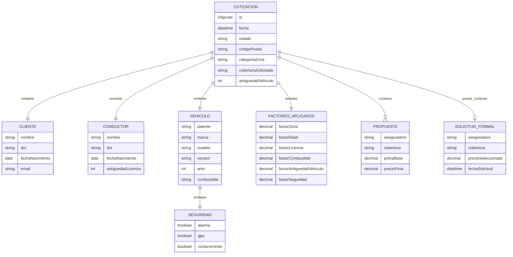
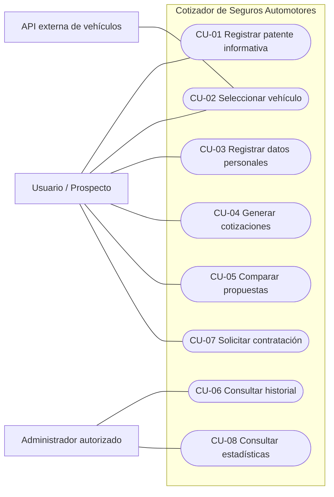
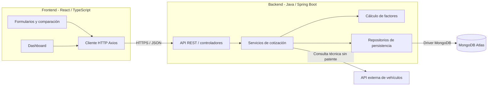
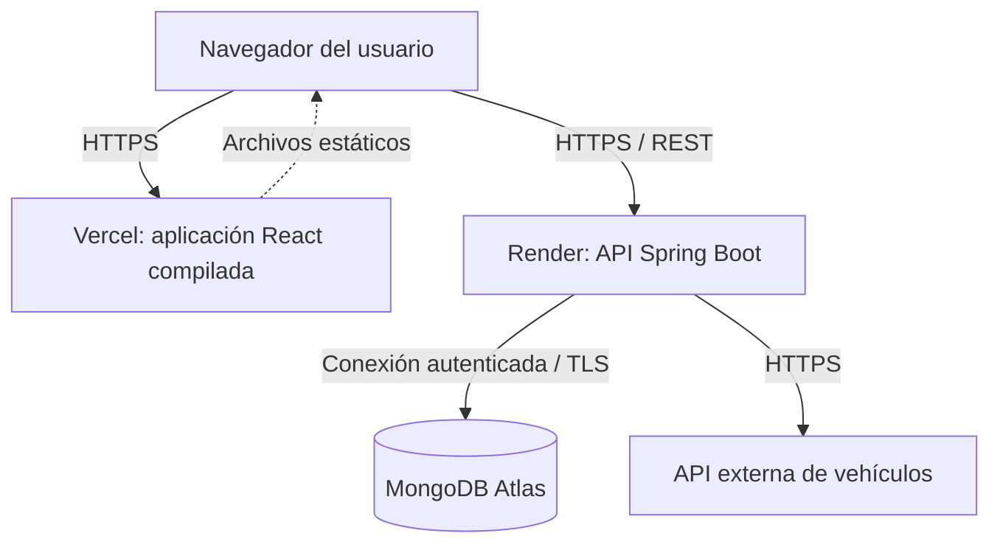

# Documentación del Sistema — Cotizador de Seguros Automotores

**Grupo 104** — Federico Quinteros, Lorenzo Pattini, Uriel Palma

---

## 1. Diseño y documentación de Base de Datos

### 1.1 Motor y justificación
Se utiliza **MongoDB Atlas** (NoSQL, orientado a documentos) en lugar de una base relacional por:
- Esquema flexible: las cotizaciones pueden tener atributos variables sin necesidad de migraciones.
- Embedding de datos relacionados (cliente, vehículo, factores) en un solo documento, evitando joins.
- Alineación natural con JSON, el formato que ya maneja el backend en sus respuestas REST.
- Escalabilidad horizontal para el crecimiento futuro del proyecto.

### 1.2 Base y colección
- **Base de datos:** `cotizador-tfi`
- **Colección principal:** `cotizaciones`

### 1.3 Decisión de diseño: embedding vs. referencias
Se optó por embeber los datos del cliente, el vehículo y los factores aplicados dentro de cada documento de cotización, en lugar de crear colecciones separadas y referenciarlas. Motivo: una cotización es un registro histórico que no debe cambiar aunque el cliente actualice sus datos más adelante — necesitamos una "foto" congelada de la información tal como era en el momento de cotizar, no una referencia viva.

### 1.4 Esquema propuesto de cotización

El siguiente documento JSON es **un ejemplo de diseño**, no una exportación de un registro productivo. Representa una solicitud con varias propuestas, sus factores y el estado necesario para medir la conversión. En MongoDB, `_id` y las fechas pueden almacenarse con tipos BSON equivalentes.

```json
{
  "_id": "ObjectId (generado por MongoDB)",
  "fecha": "2026-10-09T00:00:00",
  "estado": "COTIZADA",
  "cliente": {
    "nombre": "Cliente de ejemplo",
    "dni": "00000000",
    "fechaNacimiento": "1995-01-01",
    "email": "ejemplo@correo.test"
  },
  "conductor": {
    "nombre": "Conductor de ejemplo",
    "dni": "11111111",
    "fechaNacimiento": "2003-01-01",
    "antiguedadLicencia": 1
  },
  "vehiculo": {
    "patente": "ABC123",
    "marca": "Marca de ejemplo",
    "modelo": "Modelo de ejemplo",
    "version": "Version de ejemplo",
    "anio": 2018,
    "combustible": "Diesel",
    "dispositivosSeguridad": {
      "alarma": true,
      "gps": true,
      "cortacorriente": false
    }
  },
  "codigoPostal": "5000",
  "categoriaZona": "ALTA",
  "coberturaSolicitada": "Terceros Completo",
  "antiguedadVehiculo": 8,
  "factoresAplicados": {
    "factorZona": 1.20,
    "factorEdad": 1.20,
    "factorLicencia": 1.15,
    "factorCombustible": 1.05,
    "factorAntiguedadVehiculo": 1.10,
    "factorSeguridad": 0.92
  },
  "resultados": [
    {"aseguradora": "Aseguradora A", "cobertura": "Terceros Completo", "primaBase": 50000.00, "precioFinal": 87983.28},
    {"aseguradora": "Aseguradora B", "cobertura": "Terceros Completo", "primaBase": 48000.00, "precioFinal": 84463.95},
    {"aseguradora": "Aseguradora C", "cobertura": "Terceros Completo", "primaBase": 52000.00, "precioFinal": 91502.61}
  ],
  "solicitudFormal": null
}
```


### 1.5 Diagrama de estructura documental

El siguiente esquema muestra subdocumentos embebidos y arreglos en `cotizaciones`. No representa tablas relacionales ni colecciones independientes.



### 1.6 Estado de persistencia y evidencia

La documentación original indica que el equipo creó la base `cotizador-tfi`, la colección `cotizaciones` y un documento de prueba en MongoDB Atlas. **No se ha comprobado en esta revisión que el documento cargado coincida con el esquema ampliado de la sección 1.4.** El grupo deberá actualizarlo y adjuntar una captura o consulta de evidencia cuando corresponda.

### 1.7 Diccionario de datos resumido

| Campo / ruta | Tipo lógico | Descripción / validación |
|---|---|---|
| `_id` | ObjectId | Identificador único de la cotización, generado por MongoDB. |
| `fecha` | Fecha y hora | Momento en que se genera la cotización. |
| `estado` | Enum / texto | `COTIZADA` o `SOLICITUD_FORMAL` para el alcance inicial. |
| `cliente` | Objeto | Datos identificatorios y de contacto del titular. |
| `conductor` | Objeto | Datos de quien conducirá; puede ser una persona distinta del cliente. |
| `conductor.antiguedadLicencia` | Entero | Años completos, no negativos y compatibles con la edad. |
| `vehiculo.patente` | Texto | Dato informativo; no se envía a la API ni afecta el cálculo. |
| `vehiculo.marca/modelo/version` | Texto | Características seleccionadas desde la fuente externa. |
| `vehiculo.anio` | Entero | Año entre 1900 y el año de cotización. |
| `vehiculo.combustible` | Enum / texto | Nafta, Diésel, GNC, Híbrido o Eléctrico. |
| `vehiculo.dispositivosSeguridad` | Objeto de booleanos | Alarma, GPS y cortacorriente. |
| `codigoPostal` | Texto | Código postal utilizado para la categoría de riesgo; se conserva como texto. |
| `categoriaZona` | Enum / texto | Riesgo bajo, medio o alto según configuración. |
| `antiguedadVehiculo` | Entero | Año de cotización menos año de fabricación. |
| `coberturaSolicitada` | Texto | Cobertura elegida para comparar primas. |
| `factoresAplicados` | Objeto de decimales | Los seis multiplicadores aplicados; conserva la foto histórica del cálculo. |
| `resultados` | Arreglo de objetos | Una propuesta por aseguradora con cobertura disponible. |
| `resultados[].primaBase` | Decimal | Prima base mensual configurada. |
| `resultados[].precioFinal` | Decimal | Importe calculado y redondeado a dos decimales. |
| `solicitudFormal` | Objeto o nulo | Propuesta confirmada, fecha e importe histórico; una conversión como máximo por cotización. |

---

## 2. Definición funcional de cada módulo

### Módulo 1 — Consulta de datos del vehículo
- **Descripción:** permite registrar la patente como dato informativo y seleccionar, de forma independiente, las características técnicas del vehículo mediante información provista por una API externa de vehículos.
- **Entrada:** patente ingresada manualmente por el usuario y selección de marca, modelo, año, versión y combustible, según los datos disponibles en la API externa.
- **Proceso:** la patente no se envía a la API para consultar, validar ni recuperar información. La consulta externa se utiliza únicamente como fuente de datos para la selección de características del vehículo.
- **Salida:** objeto `vehiculo` con la patente informativa y los datos técnicos seleccionados, que se utilizarán en el módulo de cálculo y se conservarán en la cotización.

### Módulo 2 — Gestión de usuarios/prospectos
- **Descripción:** registra los datos del titular y conductor, y mantiene el historial de cotizaciones por cliente.
- **Entrada:** datos personales ingresados por el usuario (nombre, DNI, fecha de nacimiento, email).
- **Salida:** documento `cliente` embebido en cada cotización asociada.

### Módulo 3 — Motor de cálculo de cotización
- **Descripción:** aplica las reglas de negocio (factor regional, personal y del vehículo) sobre un valor base para generar el precio final.
- **Entrada:** datos del cliente, del vehículo y de la zona.
- **Salida:** documento `cotizacion` completo, persistido en la colección `cotizaciones`.

### Módulo 4 — Dashboard de estadísticas
- **Descripción:** presenta el embudo de conversión (cotización → solicitud formal) y un mapa de calor geográfico por zona.
- **Entrada:** lectura agregada sobre la colección `cotizaciones`.
- **Salida:** visualizaciones para el equipo comercial.

---

## 3. Requerimientos funcionales y no funcionales

### 3.1 Requerimientos Funcionales (RF)

Los requerimientos funcionales describen las funcionalidades que deberá proporcionar el sistema Cotizador de Seguros Automotores.

Cada requerimiento incluye criterios de aceptación que permitirán verificar su correcto funcionamiento durante las etapas de desarrollo y prueba.

### RF-01 – Registro informativo de patente

**Descripción:**

El sistema deberá permitir ingresar y registrar la patente del vehículo como dato informativo, sin utilizarla para consultar o validar información mediante una API externa.

**Criterios de aceptación:**

- CA-01.1: El usuario podrá ingresar la patente en el formulario de cotización.
- CA-01.2: La patente ingresada se almacenará junto con los datos del vehículo.
- CA-01.3: El ingreso de la patente no generará solicitudes a APIs externas.
- CA-01.4: La patente no modificará los factores ni el precio final de la cotización.

### RF-02 – Consulta y selección de datos del vehículo

**Descripción:**

El sistema deberá permitir seleccionar marca, modelo, año, versión y tipo de combustible utilizando la información disponible en una API externa de vehículos, independientemente de la patente ingresada.

**Criterios de aceptación:**

- CA-02.1: El usuario podrá consultar y seleccionar los datos técnicos del vehículo disponibles en la API externa.
- CA-02.2: La selección de los datos técnicos se realizará sin utilizar la patente.
- CA-02.3: El sistema conservará los datos seleccionados para utilizarlos en la cotización.
- CA-02.4: El sistema informará al usuario cuando la API externa no esté disponible.
- CA-02.5: No se permitirá continuar con la cotización si faltan datos técnicos obligatorios.

### RF-03 – Registro de cliente y conductor

**Descripción:**

El sistema deberá permitir registrar los datos personales del cliente y del conductor para asociarlos a las cotizaciones generadas.

**Criterios de aceptación:**

- CA-03.1: El usuario podrá ingresar nombre, DNI, fecha de nacimiento y correo electrónico del cliente y del conductor, según corresponda.
- CA-03.2: El sistema verificará que los campos obligatorios estén completos.
- CA-03.3: El sistema validará el formato del correo electrónico y la fecha de nacimiento.
- CA-03.4: Los datos ingresados se almacenarán en MongoDB Atlas.
- CA-03.5: El sistema informará los errores de validación antes de permitir continuar.

### RF-04 – Cálculo del precio de la póliza

**Descripción:**

El sistema deberá calcular el precio final mensual de una póliza aplicando las reglas de negocio vigentes sobre la prima base de la aseguradora y cobertura seleccionadas.

**Criterios de aceptación:**

- CA-04.1: El sistema obtendrá la prima base correspondiente a la aseguradora y cobertura.
- CA-04.2: El cálculo aplicará los factores definidos para zona geográfica, edad del conductor, antigüedad de licencia, combustible, antigüedad del vehículo y dispositivos de seguridad.
- CA-04.3: Los factores se aplicarán mediante la fórmula establecida en las reglas de negocio.
- CA-04.4: El resultado final se expresará en pesos argentinos, con dos decimales.
- CA-04.5: Ante datos inválidos o incompletos, el sistema no realizará el cálculo y mostrará un mensaje indicando el inconveniente.

### RF-05 – Generación y comparación de cotizaciones

**Descripción:**

El sistema deberá generar cotizaciones para distintas aseguradoras a partir de una misma solicitud, permitiendo comparar las propuestas obtenidas.

**Criterios de aceptación:**

- CA-05.1: El sistema generará una propuesta por cada aseguradora que tenga disponible la cobertura solicitada.
- CA-05.2: Todas las propuestas utilizarán los mismos datos del vehículo, conductor y ubicación geográfica.
- CA-05.3: Cada aseguradora utilizará su propia prima base configurada.
- CA-05.4: Los resultados mostrarán el nombre de la aseguradora, el tipo de cobertura y el precio mensual calculado.
- CA-05.5: El usuario podrá visualizar las propuestas ordenadas de menor a mayor precio.

### RF-06 – Historial de cotizaciones

**Descripción:**

El sistema deberá almacenar y permitir consultar las cotizaciones generadas para un cliente, conservando la información y los resultados correspondientes a cada operación.

**Criterios de aceptación:**

- CA-06.1: Cada cotización generada se almacenará en MongoDB Atlas con un identificador único.
- CA-06.2: Las cotizaciones quedarán asociadas al cliente correspondiente.
- CA-06.3: El sistema permitirá recuperar las cotizaciones anteriores de un cliente.
- CA-06.4: El historial mostrará como mínimo la fecha, el vehículo, la aseguradora, la cobertura y el importe calculado.
- CA-06.5: Las cotizaciones almacenadas conservarán los importes y factores originales aunque posteriormente se modifiquen las reglas de cálculo.

### RF-07 – Estadísticas de conversión y demanda

**Descripción:**

El sistema deberá disponer de un panel de estadísticas que permita consultar indicadores relacionados con la generación de cotizaciones, las solicitudes formales de contratación y la distribución geográfica de la demanda.

**Criterios de aceptación:**

- CA-07.1: El panel mostrará la cantidad total de cotizaciones generadas.
- CA-07.2: El sistema permitirá registrar cuándo una cotización pasa al estado de solicitud formal de contratación.
- CA-07.3: El panel mostrará la cantidad de solicitudes formales de contratación.
- CA-07.4: El sistema calculará la tasa de conversión mediante la relación entre solicitudes formales y cotizaciones generadas.
- CA-07.5: El sistema mostrará la cantidad de cotizaciones agrupadas por código postal, permitiendo identificar las zonas con mayor demanda.

**Fórmula de tasa de conversión:**

Tasa de conversión (%) = (Cantidad de cotizaciones convertidas en solicitud formal / Cantidad total de cotizaciones) × 100

Cuando no existan cotizaciones registradas, la tasa de conversión se mostrará como 0 %.

Para evitar contar múltiples veces una misma cotización, cada cotización podrá contabilizarse como convertida una única vez.

### RF-08 – Solicitud formal de contratación (funcionalidad propuesta)

**Descripción:** El sistema deberá permitir seleccionar una de las propuestas generadas y registrar la intención de contratarla, sin efectuar pagos ni emitir una póliza real.

**Criterios de aceptación:**
- CA-08.1: El usuario podrá seleccionar una propuesta existente de la cotización.
- CA-08.2: El sistema mostrará aseguradora, cobertura y precio antes de confirmar.
- CA-08.3: Al confirmar, se registrará una solicitud vinculada a la cotización en MongoDB Atlas.
- CA-08.4: El sistema conservará la fecha y los datos de la propuesta seleccionada.
- CA-08.5: No se permitirá contabilizar más de una conversión por cotización.
- CA-08.6: Cancelar la confirmación no modificará el estado de la cotización.

**Alcance:** solicitud de interés comercial, sin compra, cobro ni emisión de póliza. Requiere aprobación definitiva del equipo.

### 3.2 Requerimientos No Funcionales (RNF)

#### RNF-01 – Usabilidad

El sistema deberá contar con una interfaz clara e intuitiva, que permita a los usuarios identificar los campos obligatorios, ingresar la información necesaria y consultar los resultados de una cotización.

**Criterios de cumplimiento:**
- Los formularios deberán identificar los campos obligatorios.
- Los errores de ingreso deberán mostrarse mediante mensajes comprensibles.
- Los resultados deberán presentar claramente la aseguradora, cobertura y precio calculado.
- El usuario deberá poder identificar cómo continuar o corregir los datos ingresados.

**Verificación:** Pruebas manuales del recorrido de cotización, tanto con datos válidos como inválidos.

#### RNF-02 – Diseño adaptable (Responsive)

La interfaz deberá adaptarse a diferentes tamaños de pantalla, permitiendo utilizar las funcionalidades principales desde computadoras y dispositivos móviles.

**Criterios de cumplimiento:**
- Las pantallas principales deberán visualizarse correctamente en resoluciones de escritorio y dispositivos móviles.
- Los formularios y botones deberán permanecer accesibles.
- No deberá existir desplazamiento horizontal innecesario debido al diseño.
- La información de las cotizaciones deberá poder leerse sin superposiciones.

**Verificación:** Pruebas manuales utilizando las herramientas de dispositivos de Google Chrome, con anchos de pantalla de 375 px, 768 px y 1366 px.

#### RNF-03 – Rendimiento

El sistema deberá responder en tiempos razonables durante las operaciones principales, considerando condiciones normales de conexión y disponibilidad de los servicios externos.

**Criterios de cumplimiento:**
- Las operaciones de consulta de cotizaciones almacenadas deberán responder en un máximo de 5 segundos.
- El cálculo de una cotización con datos válidos deberá completarse en un máximo de 5 segundos cuando no dependa de llamadas externas.
- Durante las consultas a APIs externas, la interfaz deberá informar al usuario que la operación se encuentra en proceso.

**Verificación:** Pruebas manuales utilizando las herramientas de red del navegador y registros del backend, en condiciones normales de funcionamiento.

*Los tiempos no incluyen demoras excepcionales de servicios externos ni el arranque en frío del servidor de Render.*

#### RNF-04 – Seguridad y protección de datos

El sistema deberá aplicar medidas básicas de seguridad para proteger la información personal registrada y evitar la exposición de credenciales de acceso a servicios externos.

**Criterios de cumplimiento:**
- Las comunicaciones entre frontend y backend desplegados deberán utilizar HTTPS.
- Las credenciales de MongoDB Atlas y otras claves privadas deberán almacenarse mediante variables de entorno del backend.
- No deberán incluirse contraseñas ni claves privadas dentro del repositorio GitHub.
- El backend deberá validar los datos recibidos antes de procesarlos o almacenarlos.
- Las respuestas de error no deberán mostrar contraseñas ni información de configuración interna.

**Verificación:** Revisión del repositorio, configuración de Vercel y Render, y pruebas de validación de entradas en la API.

#### RNF-05 – Compatibilidad

El frontend deberá funcionar correctamente en navegadores web modernos.

**Criterios de cumplimiento:**
- La aplicación deberá poder ejecutarse en las versiones actuales de Google Chrome y Microsoft Edge.
- Las funcionalidades principales deberán mantener un comportamiento consistente en ambos navegadores.
- El sistema no deberá requerir extensiones adicionales para su utilización.

**Verificación:** Pruebas manuales del flujo principal de cotización en Chrome y Edge.

#### RNF-06 – Mantenibilidad

El código fuente deberá organizarse de manera que facilite su comprensión, modificación y ampliación por los integrantes del grupo.

**Criterios de cumplimiento:**
- El frontend deberá separar componentes, páginas, servicios y tipos de datos.
- El backend deberá mantener separadas las responsabilidades de controladores, servicios y acceso a datos.
- Las configuraciones dependientes del entorno deberán mantenerse fuera de la lógica de negocio.
- El proyecto deberá contar con instrucciones de instalación y ejecución en sus archivos README.
- El frontend deberá superar las verificaciones de compilación y análisis estático configuradas en el proyecto.

**Verificación:** Revisión de la estructura del repositorio, documentación técnica y ejecución de `npm run lint` y `npm run build`.

#### RNF-07 – Manejo de errores

El sistema deberá informar de manera comprensible los errores que puedan ocurrir durante la carga de información, las consultas externas o la generación de cotizaciones.

**Criterios de cumplimiento:**
- Los formularios deberán identificar entradas inválidas o incompletas.
- Si una API externa no responde, el sistema deberá mostrar un mensaje informativo.
- Si no puede generarse una cotización, se deberá informar al usuario sin mostrar errores técnicos internos.
- La aplicación no deberá quedar bloqueada permanentemente ante una solicitud fallida.

**Verificación:** Pruebas manuales con campos inválidos, interrupciones simuladas de conexión y respuestas de error del backend.

#### RNF-08 – Despliegue y ejecución

El sistema deberá poder ejecutarse en un entorno local de desarrollo y publicarse utilizando las plataformas seleccionadas por el equipo.

**Criterios de cumplimiento:**
- El frontend deberá poder ejecutarse localmente mediante `npm install` y `npm run dev`.
- El backend deberá contar con instrucciones para su ejecución local.
- El frontend deberá poder generar una compilación de producción mediante `npm run build`.
- La aplicación deberá poder desplegarse en Vercel y comunicarse con el backend publicado en Render.
- El backend deberá poder conectarse a MongoDB Atlas mediante su configuración correspondiente.

**Verificación:** Ejecución local de ambos proyectos, compilación del frontend y prueba de una operación completa de cotización en el entorno desplegado.

---

## 4. Reglas de Negocio y Lógica de Cálculo de Cotizaciones

### 4.1 Descripción general

El sistema Cotizador de Seguros Automotores permitirá generar cotizaciones personalizadas a partir de los datos del vehículo, del conductor y de su ubicación geográfica.

Para determinar el precio de una póliza se utilizará un algoritmo de cálculo multicriterio que aplicará diferentes factores de ajuste sobre una prima base establecida para cada aseguradora y tipo de cobertura.

Los factores contemplados serán:

- Zona geográfica del conductor.
- Edad del conductor.
- Antigüedad de la licencia de conducir.
- Tipo de combustible del vehículo.
- Antigüedad del vehículo.
- Dispositivos de seguridad instalados.

El sistema permitirá generar y comparar cotizaciones de distintas aseguradoras utilizando los mismos datos ingresados por el usuario.

**Los importes y porcentajes definidos son valores simulados con fines académicos y no representan tarifas reales de compañías aseguradoras.**

### 4.2 Fórmula general de cálculo

El precio final mensual se calculará mediante la siguiente fórmula:

**Prima Final = Prima Base × Factor Zona × Factor Edad × Factor Licencia × Factor Combustible × Factor Antigüedad Vehículo × Factor Seguridad**

Donde:

| Variable | Descripción |
|---|---|
| Prima Base | Importe inicial establecido por cada aseguradora para una cobertura determinada. |
| Factor Zona | Ajuste correspondiente al nivel de riesgo de la zona geográfica. |
| Factor Edad | Ajuste según la edad del conductor. |
| Factor Licencia | Ajuste según la antigüedad de la licencia de conducir. |
| Factor Combustible | Ajuste según el tipo de combustible del vehículo. |
| Factor Antigüedad Vehículo | Ajuste según los años transcurridos desde el año de fabricación del automóvil. |
| Factor Seguridad | Descuento aplicado por los dispositivos de seguridad instalados. |
| Prima Final | Importe mensual resultante de aplicar todos los factores. |

Cada factor tendrá como valor de referencia **1,00**, que representa la ausencia de modificaciones.

- Un factor mayor que 1,00 representa un recargo.
- Un factor menor que 1,00 representa un descuento.
- Un factor igual a 1,00 no modifica el importe.

Los factores se aplicarán de forma multiplicativa y el resultado se redondeará a dos decimales al finalizar el cálculo.

### 4.3 Reglas de negocio

#### RN-01 – Factor geográfico

El sistema aplicará un factor según el código postal informado por el conductor.

Para el alcance inicial se establecerá una clasificación de códigos postales de prueba en tres categorías.

| Clasificación | Factor | Ajuste |
|---|---|---|
| Riesgo bajo | 0,95 | Descuento del 5 % |
| Riesgo medio | 1,00 | Sin modificación |
| Riesgo alto | 1,20 | Recargo del 20 % |

La relación entre códigos postales y categorías de riesgo será definida mediante una configuración interna.

Si el código postal no se encuentra configurado, el sistema informará que no es posible determinar el factor geográfico y solicitará una ubicación válida.

#### RN-02 – Factor por edad del conductor

El sistema calculará la edad del conductor a partir de su fecha de nacimiento.

| Edad del conductor | Factor | Ajuste |
|---|---|---|
| Menor de 18 años | No aplica | No se permite cotizar |
| Entre 18 y 24 años | 1,20 | Recargo del 20 % |
| Entre 25 y 65 años | 1,00 | Sin modificación |
| Mayor de 65 años | 1,10 | Recargo del 10 % |

El conductor deberá tener al menos 18 años para generar una cotización.

La edad se calculará considerando la fecha en la que se realiza la solicitud.

#### RN-03 – Factor por antigüedad de licencia

El sistema aplicará un ajuste según los años completos transcurridos desde la obtención de la licencia de conducir.

| Antigüedad | Factor | Ajuste |
|---|---|---|
| Menos de 2 años | 1,15 | Recargo del 15 % |
| Entre 2 y 5 años, inclusive | 1,05 | Recargo del 5 % |
| Más de 5 años | 1,00 | Sin modificación |

La antigüedad no podrá ser negativa y deberá ser coherente con la edad del conductor.

#### RN-04 – Factor por tipo de combustible

El sistema aplicará un factor según el tipo de combustible seleccionado.

| Combustible | Factor | Ajuste |
|---|---|---|
| Nafta | 1,00 | Sin modificación |
| Diésel | 1,05 | Recargo del 5 % |
| GNC | 1,03 | Recargo del 3 % |
| Híbrido | 0,98 | Descuento del 2 % |
| Eléctrico | 0,95 | Descuento del 5 % |

El tipo de combustible formará parte de los datos técnicos obtenidos mediante la consulta a la API externa de vehículos.

#### RN-05 – Factor por antigüedad del vehículo

El sistema deberá aplicar un factor según la antigüedad del automóvil, calculada a partir de su año de fabricación.

Para simplificar el modelo académico, se utilizará la siguiente fórmula:

**Antigüedad del vehículo = Año de cotización − Año de fabricación**

| Antigüedad del vehículo | Factor | Ajuste |
|---|---|---|
| 0 a 2 años | 0,95 | Descuento del 5 % |
| 3 a 5 años | 1,00 | Sin modificación |
| 6 a 10 años | 1,10 | Recargo del 10 % |
| 11 a 15 años | 1,20 | Recargo del 20 % |
| Más de 15 años | 1,35 | Recargo del 35 % |

El cálculo se realizará utilizando el año correspondiente a la fecha de generación de la cotización.

El año de fabricación no podrá ser posterior al año de cotización ni anterior a 1900.

Para esta primera versión, todos los vehículos dentro del rango permitido podrán cotizarse, independientemente de su antigüedad. No se establecerán exclusiones por antigüedad ni restricciones adicionales por tipo de cobertura.

**Ejemplo:**

Si un vehículo fue fabricado en 2018 y la cotización se realiza en 2026:

Antigüedad = 2026 − 2018 = 8 años.

Por lo tanto, corresponde aplicar el factor **1,10**, equivalente a un recargo del 10 %.

Este factor permite que el año de fabricación influya directamente en el precio calculado.

#### RN-06 – Factor por dispositivos de seguridad

El sistema aplicará descuentos según los dispositivos de seguridad declarados por el usuario.

| Dispositivo | Descuento |
|---|---|
| Alarma | 3 % |
| GPS | 5 % |
| Cortacorriente | 2 % |

Los descuentos serán acumulativos hasta un máximo del 10 %.

**Factor Seguridad = 1 − Suma de descuentos aplicables**

Por ejemplo, si el vehículo cuenta con alarma y GPS:

Factor Seguridad = 1 − (0,03 + 0,05)

**Factor Seguridad = 0,92**

Si no posee dispositivos de seguridad, el factor será 1,00.

#### RN-07 – Prima base por aseguradora y cobertura

Cada aseguradora tendrá una prima base configurada para cada cobertura que ofrezca.

Para la primera versión del sistema se trabajará con tres aseguradoras ficticias y tres tipos de cobertura.

| Aseguradora | Responsabilidad civil | Terceros completo | Todo riesgo |
|---|---:|---:|---:|
| Aseguradora A | $30.000 | $50.000 | $80.000 |
| Aseguradora B | $32.000 | $48.000 | $85.000 |
| Aseguradora C | $28.000 | $52.000 | $78.000 |

Los importes representan primas base mensuales simuladas, expresadas en pesos argentinos.

Todas las aseguradoras utilizarán la misma fórmula general durante la primera versión. La diferencia de precios dependerá de la prima base configurada para cada aseguradora y cobertura.

#### RN-08 – Registro informativo de la patente

La patente deberá ser ingresada por el usuario y almacenada junto con los datos del vehículo.

Tendrá carácter exclusivamente informativo.

No se utilizará para consultar APIs externas, recuperar características técnicas del vehículo ni modificar el importe de la cotización.

#### RN-09 – Obtención de datos técnicos del vehículo

La información técnica se obtendrá mediante una API externa que permita consultar y seleccionar características del vehículo independientemente de su patente.

Los datos contemplados serán:

- Marca.
- Modelo.
- Año de fabricación.
- Versión.
- Tipo de combustible.

El año de fabricación será utilizado para calcular el factor de antigüedad del vehículo.

En caso de que la API no esté disponible, el sistema informará el inconveniente y no continuará con la cotización hasta disponer de los datos obligatorios.

#### RN-10 – Validación de información

Antes de generar una cotización, el backend deberá verificar que los datos obligatorios estén completos y sean válidos.

Se contemplarán las siguientes validaciones:

- Edad mínima del conductor: 18 años.
- Fecha de nacimiento válida y no futura.
- Antigüedad de licencia no negativa y coherente con la edad.
- Código postal existente dentro de la configuración.
- Marca, modelo, versión y año de fabricación válidos.
- Año de fabricación comprendido entre 1900 y el año de cotización.
- Tipo de combustible admitido.
- Cobertura seleccionada y disponible.

Si algún dato no cumple las condiciones, el sistema deberá informar el error y evitar la generación de la cotización hasta que sea corregido.

#### RN-11 – Redondeo de importes

El sistema conservará la precisión decimal durante la aplicación de todos los factores.

El redondeo se realizará una única vez al finalizar el cálculo de cada propuesta.

El importe final se expresará en pesos argentinos con dos decimales.

Se utilizará el criterio de redondeo convencional, mediante `BigDecimal` y `RoundingMode.HALF_UP` en Java.

#### RN-12 – Persistencia del historial

Cada cotización generada se almacenará en MongoDB Atlas para permitir su consulta posterior.

Se conservarán como mínimo:

- Identificador de la cotización.
- Identificación del usuario o prospecto.
- Datos del vehículo, incluyendo la patente informativa.
- Año de fabricación y antigüedad calculada del vehículo.
- Datos del conductor utilizados.
- Código postal y categoría de riesgo.
- Factores aplicados.
- Aseguradoras y coberturas cotizadas.
- Primas base e importes finales.
- Fecha y hora de generación.

Las cotizaciones anteriores conservarán sus valores históricos aunque posteriormente cambien las primas base o los factores configurados.

#### RN-13 – Comparación de cotizaciones

El sistema generará una propuesta por cada aseguradora que ofrezca la cobertura solicitada.

Todas las propuestas utilizarán los mismos datos del vehículo y conductor y los mismos factores de ajuste, diferenciándose por la prima base de cada aseguradora.

Los resultados mostrarán:

- Nombre de la aseguradora.
- Tipo de cobertura.
- Precio mensual calculado.

Las propuestas podrán ordenarse de menor a mayor precio.

Si una aseguradora no ofrece una determinada cobertura, no se generará una cotización para esa combinación.

### 4.4 Ejemplo de aplicación del algoritmo

Se presenta un ejemplo de cálculo correspondiente a una cobertura de Terceros Completo.

#### Datos ingresados

| Dato | Valor |
|---|---|
| Edad del conductor | 23 años |
| Antigüedad de licencia | 1 año |
| Zona geográfica | Riesgo alto |
| Combustible | Diésel |
| Año del vehículo | 2018 |
| Año de cotización | 2026 |
| Antigüedad del vehículo | 8 años |
| Dispositivos de seguridad | Alarma y GPS |
| Cobertura | Terceros Completo |

#### Factores aplicables

| Concepto | Factor |
|---|---:|
| Zona geográfica | 1,20 |
| Edad del conductor | 1,20 |
| Antigüedad de licencia | 1,15 |
| Combustible | 1,05 |
| Antigüedad del vehículo | 1,10 |
| Dispositivos de seguridad | 0,92 |

#### Cálculo para Aseguradora A

Prima base: $50.000.

**Prima Final = 50.000 × 1,20 × 1,20 × 1,15 × 1,05 × 1,10 × 0,92**

**Prima Final = $87.983,28**

Este procedimiento se repetirá para las demás aseguradoras, utilizando sus respectivas primas base.

#### Resultados comparativos

| Aseguradora | Prima base | Prima final |
|---|---:|---:|
| Aseguradora A | $50.000 | $87.983,28 |
| Aseguradora B | $48.000 | $84.463,95 |
| Aseguradora C | $52.000 | $91.502,61 |

Los resultados son simulaciones académicas y no representan ofertas comerciales reales.

### 4.5 Implementación técnica prevista

La lógica de cotización se implementará en el backend desarrollado con Java y Spring Boot.

El frontend React + TypeScript recopilará los datos ingresados por el usuario, los enviará a la API REST y presentará las propuestas calculadas.

El backend deberá:

1. Recibir la solicitud de cotización.
2. Validar los datos ingresados.
3. Calcular la edad del conductor y la antigüedad de la licencia.
4. Calcular la antigüedad del vehículo a partir de su año de fabricación.
5. Determinar los factores de ajuste.
6. Recuperar las primas base configuradas.
7. Aplicar la fórmula de cálculo por aseguradora.
8. Redondear los importes finales.
9. Almacenar la cotización y sus factores en MongoDB Atlas.
10. Devolver las propuestas al frontend.

Las primas base y los factores podrán almacenarse como datos configurables en MongoDB Atlas, evitando incorporar valores fijos directamente en la lógica de cálculo.

Para el desarrollo inicial se utilizará un único motor de cotización compartido por las aseguradoras ficticias.

### 4.6 Consideraciones y limitaciones

El algoritmo constituye un modelo simplificado diseñado con fines académicos.

No contempla todos los factores reales del mercado asegurador, como siniestralidad histórica, valor comercial del automóvil, tasas regulatorias, franquicias, impuestos o condiciones contractuales.

En esta primera versión, la marca, el modelo y la versión serán datos identificatorios, mientras que el año de fabricación sí modificará el precio mediante el factor de antigüedad.

Los factores y primas base podrán ajustarse durante el desarrollo, siempre que se documenten los cambios y se mantenga la coherencia entre las reglas definidas y el algoritmo implementado.

El objetivo principal es demostrar la aplicación de reglas de negocio, la automatización del cálculo, la comparación entre aseguradoras y la integración entre frontend, backend y base de datos.

---

## 5. Diagramas de análisis y arquitectura

### 5.1 Diagrama de flujo general

Archivo previsto en el repositorio: `docs/TP_Final_Diagrama_de_Flujo.jpg`. **Verificar el contenido de la imagen antes de entregar**, porque este documento no modifica automáticamente ese archivo. El flujo acordado es: registro de patente informativa → consulta externa por selección de características (sin patente) → datos de conductor y zona → validación → cálculo → comparación → eventual solicitud formal.

### 5.2 Diagrama de clases propuesto

Representa entidades de dominio, atributos y relaciones del backend Java + Spring Boot; es un **diseño previsto, no evidencia de clases implementadas**.


### 5.3 Diagrama de casos de uso (visión funcional)



Es una representación funcional de actores y casos de uso en Mermaid. Para una entrega UML estricta, reproducir estos elementos en un diagrama de casos de uso UML (actores, elipses y límite del sistema).

### 5.4 Diagrama de componentes propuesto



### 5.5 Diagrama de despliegue previsto



El despliegue se presenta como arquitectura objetivo. Las URL definitivas, variables de entorno, CORS y disponibilidad de la API se verificarán durante la integración. El navegador consume la API desplegada; Vercel aloja el frontend y no ejecuta el algoritmo de cotización.

---

## 6. Casos de uso

### 6.1 Actores y alcance

- **Usuario / Prospecto:** registra los datos, cotiza, compara y eventualmente manifiesta intención de contratar.
- **Administrador autorizado:** consulta historial según permisos y visualiza estadísticas de conversión y demanda.
- **API externa de vehículos:** servicio secundario que entrega información por selección de características, nunca a partir de la patente.

El acceso al historial requiere autorización. El mecanismo de autenticación y roles debe acordarse e implementarse antes de exponer datos personales. La propuesta inicial no requiere pagos ni emisión de pólizas.

### 6.2 Catálogo

| Caso | Nombre | Actor | RF |
|---|---|---|---|
| CU-01 | Registrar patente informativa | Usuario | RF-01 |
| CU-02 | Seleccionar datos del vehículo | Usuario, API externa | RF-02 |
| CU-03 | Registrar cliente y conductor | Usuario | RF-03 |
| CU-04 | Generar cotizaciones | Usuario | RF-04, RF-05 |
| CU-05 | Comparar propuestas | Usuario | RF-05 |
| CU-06 | Consultar historial | Usuario autorizado | RF-06 |
| CU-07 | Solicitar contratación | Usuario | RF-08 |
| CU-08 | Consultar estadísticas | Administrador | RF-07 |

### CU-01 – Registrar patente informativa

- **Precondición:** solicitud de cotización iniciada.
- **Flujo principal:** (1) El sistema muestra el campo patente. (2) El usuario ingresa el dato. (3) El sistema lo incorpora a la solicitud. (4) Al guardar la cotización, conserva la patente.
- **Alternativa:** antes de confirmar, el usuario puede corregir el valor.
- **Postcondición:** la patente queda almacenada, sin consulta externa ni efecto en el cálculo.
- **Reglas:** RN-08.

### CU-02 – Seleccionar datos del vehículo

- **Precondición:** el usuario dispone del formulario y el servicio externo está accesible.
- **Flujo principal:** (1) El sistema consulta el catálogo externo. (2) El usuario selecciona marca y modelo. (3) Selecciona año, versión y combustible entre opciones disponibles. (4) Se validan los datos obligatorios y se conservan.
- **Alternativas:** servicio no disponible → mensaje y bloqueo de avance; datos incompletos → solicitar corrección; cambio de marca → actualizar opciones dependientes.
- **Postcondición:** información técnica disponible para cotizar, independientemente de la patente.
- **Reglas:** RN-05, RN-09, RN-10.

### CU-03 – Registrar cliente y conductor

- **Precondición:** proceso de cotización iniciado.
- **Flujo principal:** (1) El usuario carga datos de cliente y conductor. (2) Informa fecha de nacimiento y antigüedad de licencia del conductor. (3) El sistema valida obligatoriedad y formatos. (4) Conserva los datos para la solicitud y posterior persistencia.
- **Alternativas:** email inválido o campos vacíos → pedir corrección; conductor menor de 18 → no permitir cotizar.
- **Postcondición:** información del cliente y conductor disponible y validada.
- **Reglas:** RN-02, RN-03, RN-10.

### CU-04 – Generar cotizaciones

- **Precondición:** información obligatoria válida, código postal configurado y cobertura seleccionada.
- **Flujo principal:** (1) El usuario solicita cotizar. (2) El frontend envía datos por REST. (3) El backend valida. (4) Recupera primas base y seis factores. (5) Aplica la fórmula y redondea al final. (6) Genera propuestas de las aseguradoras con cobertura disponible. (7) Guarda los datos y devuelve resultados.
- **Alternativas:** datos inválidos → respuesta de validación; código postal desconocido → solicitar corrección; sin aseguradoras disponibles → informar; fallo de persistencia → no presentar la operación como guardada.
- **Postcondición:** cotización persistida con importes y factores históricos cuando la operación finaliza correctamente.
- **Reglas:** RN-01 a RN-07, RN-10 a RN-13.

### CU-05 – Comparar propuestas

- **Precondición:** existe al menos una propuesta calculada.
- **Flujo principal:** (1) Se muestran aseguradora, cobertura e importe. (2) Se permite ordenar por precio. (3) El usuario consulta y selecciona una propuesta si desea avanzar.
- **Alternativas:** una sola aseguradora → mostrar una propuesta; ninguna → mensaje informativo.
- **Postcondición:** propuestas comparadas, sin contratación automática.
- **Reglas:** RN-07, RN-13.

### CU-06 – Consultar historial de cotizaciones

- **Precondición:** existe un mecanismo de acceso autorizado y una identificación válida del cliente.
- **Flujo principal:** (1) El usuario autorizado accede al historial. (2) Solicita las cotizaciones del cliente. (3) El backend verifica permisos. (4) Recupera y muestra fechas, vehículo, propuestas y valores históricos.
- **Alternativas:** sin registros → listado vacío; sin autorización → denegar; fallo de BD → informar sin mostrar datos internos.
- **Postcondición:** consulta de registros sin modificarlos.
- **Reglas:** RN-12.

### CU-07 – Solicitar contratación de una cobertura

- **Precondición:** cotización generada y propuesta seleccionada.
- **Flujo principal:** (1) El usuario selecciona una propuesta. (2) El sistema muestra resumen. (3) El usuario confirma. (4) Se registra `solicitudFormal` y estado `SOLICITUD_FORMAL`. (5) Se comunica el resultado.
- **Alternativas:** cancelar → sin cambios; segunda confirmación → no duplicar conversión; error al guardar → mostrar fallo.
- **Postcondición:** intención comercial registrada, sin emitir póliza ni cobrar.
- **Reglas:** RN-12, RN-13. **Asociado a RF-08 propuesto.**

### CU-08 – Consultar estadísticas y conversión

- **Precondición:** acceso administrativo autorizado.
- **Flujo principal:** (1) El administrador solicita el dashboard. (2) El backend agrega cotizaciones por código postal y cuenta cotizaciones y conversiones únicas. (3) Calcula tasa = convertidas / total × 100. (4) Muestra indicadores.
- **Alternativas:** sin cotizaciones → totales y tasa en 0; error de consulta → mensaje controlado.
- **Postcondición:** visualización estadística sin modificar registros.
- **Reglas:** RN-12, RN-13.

---

## 7. Matriz de trazabilidad y pruebas previstas

La siguiente matriz vincula requerimientos, reglas y casos de uso. **Los CP son identificadores de pruebas a diseñar y ejecutar**, no pruebas aprobadas.

| RF | Descripción resumida | CU | RN | CP previstos |
|---|---|---|---|---|
| RF-01 | Patente informativa | CU-01 | RN-08 | CP-01, CP-02 |
| RF-02 | Selección de vehículo | CU-02 | RN-05, RN-09, RN-10 | CP-03, CP-04, CP-05 |
| RF-03 | Cliente y conductor | CU-03 | RN-02, RN-03, RN-10 | CP-06, CP-07, CP-08 |
| RF-04 | Cálculo de prima | CU-04 | RN-01 a RN-07, RN-10, RN-11 | CP-09 a CP-12 |
| RF-05 | Cotización multiaseguradora | CU-04, CU-05 | RN-07, RN-13 | CP-13, CP-14 |
| RF-06 | Historial | CU-06 | RN-12 | CP-15, CP-16, CP-22 |
| RF-07 | Estadísticas | CU-08 | RN-12, RN-13 | CP-17 a CP-19 |
| RF-08 | Solicitud formal | CU-07 | RN-12, RN-13 | CP-20, CP-21 |

### 7.1 Pruebas funcionales propuestas

| CP | Escenario | Resultado esperado |
|---|---|---|
| CP-01 | Registrar patente | Se conserva sin consultarla en la API. |
| CP-02 | Cambiar solo la patente | Precio y factores permanecen iguales. |
| CP-03 | Seleccionar datos técnicos válidos | Se conservan marca, modelo, año, versión y combustible. |
| CP-04 | API de vehículos no disponible | Mensaje claro; no se avanza sin datos obligatorios. |
| CP-05 | Año de fabricación futuro | Se rechaza. |
| CP-06 | Registrar cliente y conductor válidos | Datos asociados a la cotización. |
| CP-07 | Email con formato inválido | Error de validación. |
| CP-08 | Conductor menor de 18 | No se calcula. |
| CP-09 | Cotización válida con valores conocidos | Importe coincide con la fórmula documentada. |
| CP-10 | Vehículo de 8 años | Factor antigüedad = 1,10. |
| CP-11 | Alarma y GPS | Factor seguridad = 0,92. |
| CP-12 | Código postal no configurado | Error y cálculo bloqueado. |
| CP-13 | Tres aseguradoras disponibles | Tres propuestas correspondientes a la cobertura. |
| CP-14 | Ordenar propuestas por importe | Orden ascendente con precios correctos. |
| CP-15 | Consultar historial existente | Se recuperan cotizaciones del cliente autorizado. |
| CP-16 | Cambiar tarifas después de cotizar | No se alteran registros históricos. |
| CP-17 | Dashboard con datos | Total de cotizaciones correcto. |
| CP-18 | Conversiones registradas | Tasa correcta, sin conversiones duplicadas. |
| CP-19 | Cotizaciones por código postal | Agrupación correcta por ubicación. |
| CP-20 | Confirmar solicitud | Registro vinculado a propuesta y cotización. |
| CP-21 | Cancelar o confirmar dos veces | No se crea solicitud por cancelación ni conversión duplicada. |
| CP-22 | Solicitud de historial no autorizada | Acceso rechazado y datos no divulgados. |

### 7.2 Verificación de requisitos no funcionales

| RNF | Evidencia prevista |
|---|---|
| RNF-01 Usabilidad | Recorrido manual con entradas válidas e inválidas. |
| RNF-02 Responsive | Capturas/pruebas a 375, 768 y 1366 px. |
| RNF-03 Rendimiento | Medición de consultas y cálculo interno; registrar entorno y excluir arranque en frío documentado. |
| RNF-04 Seguridad | HTTPS, revisión de secretos, validaciones y pruebas de autorización. |
| RNF-05 Compatibilidad | Flujo principal ejecutado en Chrome y Edge. |
| RNF-06 Mantenibilidad | Estructura, README, `npm run lint`, `npm run build`. |
| RNF-07 Manejo de errores | API caída y entradas inválidas sin mensajes técnicos internos. |
| RNF-08 Despliegue | Ejecución local e integración desplegada Vercel–Render–Atlas. |

### 7.3 Estado de las pruebas

Los estados propuestos son **Pendiente**, **Aprobado**, **Fallido** y **Bloqueado**. Todos los CP anteriores deben considerarse *pendientes de ejecución* hasta que exista evidencia. Cambios futuros a un RF o RN requieren revisar los CU y CP vinculados.

---

## 8. Parametrización de reglas y alcance de implementación

Los factores RN-01 a RN-06 y las primas RN-07 descritos en la sección 4 constituyen **la configuración inicial simulada propuesta** para el MVP. Las tablas de rangos y porcentajes son la fuente de verdad funcional; la implementación deberá usar los mismos valores.

Para evitar duplicar constantes en múltiples servicios, se propone una configuración centralizada en el backend y, cuando el grupo implemente su persistencia, en documentos de configuración de MongoDB Atlas.

| Parámetro | Valores iniciales de referencia | Fuente |
|---|---|---|
| `factoresZona` | Bajo 0,95; Medio 1,00; Alto 1,20 | RN-01 |
| `factoresEdad` | 18–24: 1,20; 25–65: 1,00; >65: 1,10 | RN-02 |
| `factoresLicencia` | <2: 1,15; 2–5: 1,05; >5: 1,00 | RN-03 |
| `factoresCombustible` | Nafta 1,00; Diésel 1,05; GNC 1,03; Híbrido 0,98; Eléctrico 0,95 | RN-04 |
| `factoresAntiguedadVehiculo` | 0–2: 0,95; 3–5: 1,00; 6–10: 1,10; 11–15: 1,20; >15: 1,35 | RN-05 |
| `descuentosSeguridad` | Alarma 3 %; GPS 5 %; Cortacorriente 2 %; máximo 10 % | RN-06 |
| `primasBase` | Tres aseguradoras × tres coberturas | RN-07 |
| `codigosPostales` | Tabla acotada de códigos postales de prueba con categoría de riesgo | RN-01 |

**Cálculo definido:** multiplicar los seis factores sobre la prima base y aplicar `BigDecimal`/`HALF_UP` con dos decimales al final; guardar factores y resultado por cada cotización. No se contempla recálculo retroactivo del historial.

### 8.1 Estado documental frente a implementación

Este documento especifica el **sistema previsto**, no una certificación de funcionamiento completo. La evidencia existente declarada en la documentación original es la creación inicial de la base y una colección de prueba; la consistencia con el nuevo modelo debe verificarse. No se presentan los diagramas, los CP ni las integraciones como funcionalidad ya terminada.

---

## 9. Glosario breve

| Término | Significado |
|---|---|
| Prima base | Precio inicial mensual de una combinación aseguradora/cobertura antes de ajustes. |
| Prima final | Resultado mensual luego de aplicar los seis factores y redondear. |
| Factor | Multiplicador del precio: 1,00 sin cambio; >1 recargo; <1 descuento. |
| Patente informativa | Identificador ingresado por el usuario, sin uso para consulta de vehículos ni factor de precio. |
| Prospecto | Persona que consulta una cotización, sin ser todavía contratante de una póliza. |
| Propuesta | Precio calculado por una aseguradora y cobertura determinados. |
| Solicitud formal | Manifestación de interés registrada; no implica contrato, pago ni emisión real. |
| Conversión | Cotización con una solicitud formal confirmada, contada una vez. |
| Embedding | Almacenamiento de subdocumentos dentro de un documento MongoDB. |
| API REST | Interfaz HTTP para intercambiar datos entre frontend y backend. |
